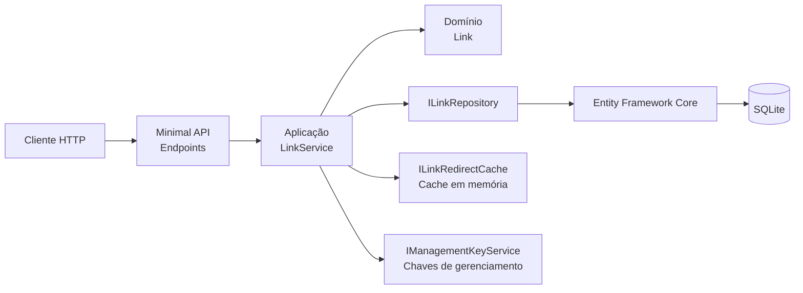

## 🎃 Halloween - Desafio 2

Oi, eu sou o João Bosco dos reis becker e este é o espaço onde compartilho minha jornada de aprendizado durante o desafio **Halloween 2026**, realizado pelo [balta.io](https://balta.io). 👻

Aqui você vai encontrar projetos, exercícios e códigos que estou desenvolvendo durante o desafio.

### Sobre este desafio
Neste desafio o objetivo é criar um encurtador de URLs completo utilizando os conceitos de Spec-Driven Development

#### O que foi implementado
- API para criar links curtos, redirecionar para a URL original e consultar estatísticas de acesso.

### Arquitetura



Os endpoints delegam as regras ao `LinkService`. A infraestrutura implementa as abstrações da aplicação; o SQLite é a fonte persistente dos links e contagens, enquanto o cache em memória guarda destinos para acelerar redirecionamentos.

**Próximo passo:** implementar o padrão Transactional Outbox para persistir mensagens junto com as alterações de dados e publicá-las de forma confiável.

As decisões estão documentadas em [`docs/adr/`](docs/adr/README.md).

### Executar com Docker Compose

Com Docker instalado, inicie a API e construa a imagem com:

```bash
docker compose up --build
```

A API ficará disponível em `http://localhost:5208`. O banco SQLite é mantido no volume `urlshortener_data`.

### Rotas disponíveis

| Método | Rota | Descrição |
| --- | --- | --- |
| `POST` | `/api/links` | Cria um link curto. Retorna a URL curta, o código e a chave de gerenciamento. |
| `GET` | `/{code}` | Redireciona para a URL original associada ao código. |
| `GET` | `/api/links/{code}/stats` | Consulta as estatísticas do link. Requer o cabeçalho `X-Management-Key` com a chave retornada na criação. |

Para encurtar uma URL, envie um `POST` para `/api/links` com este payload:

```json
{
	"targetUrl": "https://example.com/minha-pagina",
	"code": "MINHALINK",
	"expiresAtUtc": "2026-12-31T23:59:59Z"
}
```

`targetUrl` é obrigatório. `code` e `expiresAtUtc` são opcionais; se o código não for informado, a API gera um automaticamente. A resposta inclui `shortUrl`, `code` e `managementKey`.

Exemplo com `curl`:

```bash
curl -X POST "http://localhost:5000/api/links" \\
	-H "Content-Type: application/json" \\
	-d '{"targetUrl":"https://example.com/minha-pagina"}'
```

Neste processo eu aprendi:

* ✅ Spec driven development(SDD) é uma metodologia de engenharia de software bem detalhada e estruturada onde as especificações são escritas de formas bem detalhas para garantir e aumentar o nível de acertividade na escrita do seu software.

# Filosofia Central 

*  Intenção em Primeiro Lugar: Concentra-se no que construir e porquê, antes de descobrir como implementá-lo. 

 * Contexto Nativo da IA: Resolve problemas de perda de contexto e alucinações em assistentes de codificação de IA (como o GitHub Copilot ou o Claude Code) fornecendo-lhes restrições explícitas e estruturadas em vez de instruções vagas. 

* Artefatos em Evolução: Substitui a documentação ad hoc por arquivos dinâmicos (como spec.md, plan.md e tasks.md) que ancoram a base de código

## Bagde


## Problema
É perceptivel a quantidade considerável de token que é consumido ao fazer uso do SDD,devido ao uso de RAG, skill e rules já nativas além do SDD eu não consideraria um problema mas uma questão de **Ponto de atenção** apenas.


## Sobre o Halloween 2026
O desafio **Halloween 2026** consiste em implementar implementar o modelo Spec Driven Development de ponta a ponta, criando apps completas com IA.

### Veja meu progresso no desafio
[Incluir link para o repositório central]
